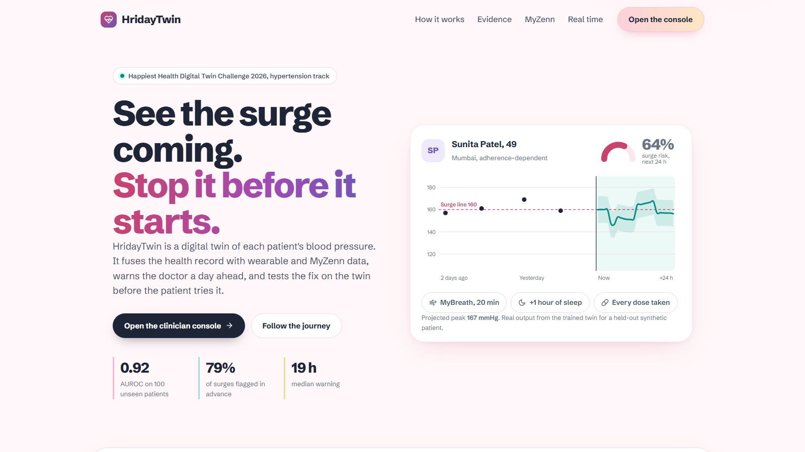
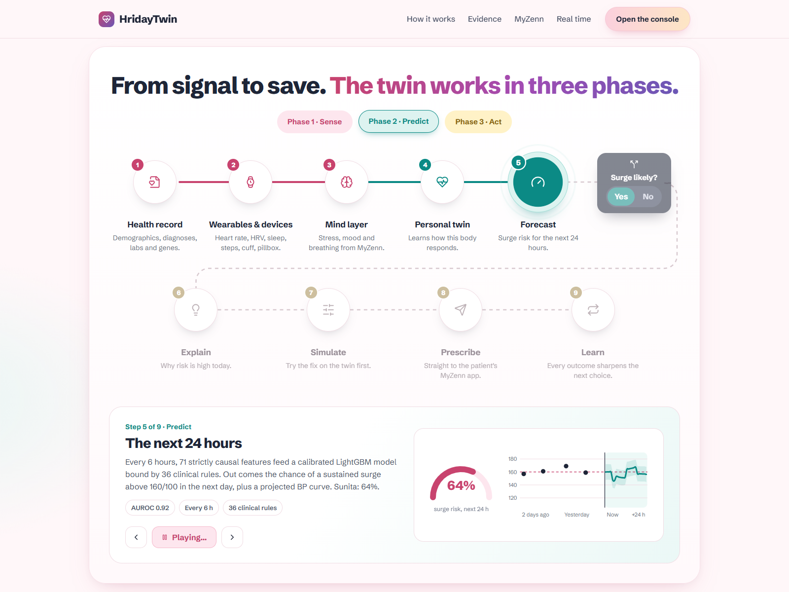
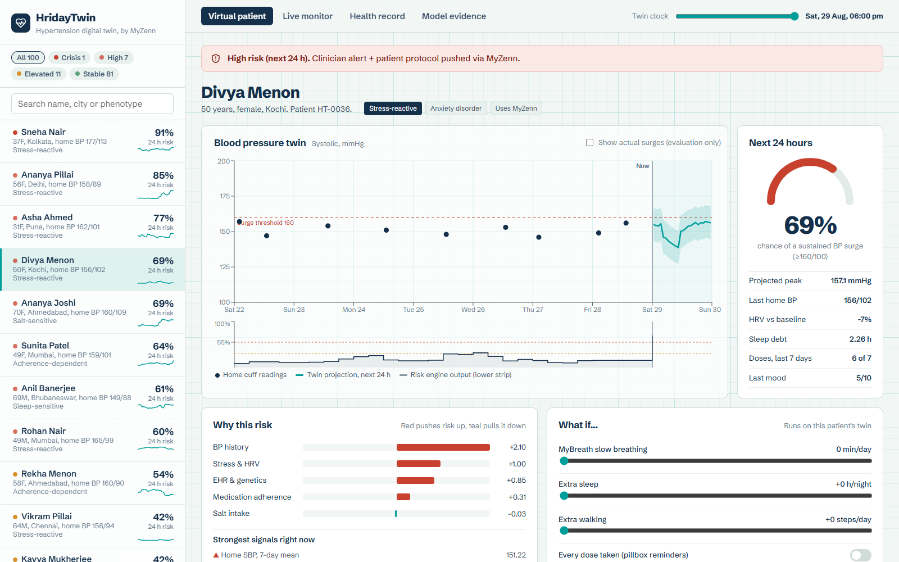
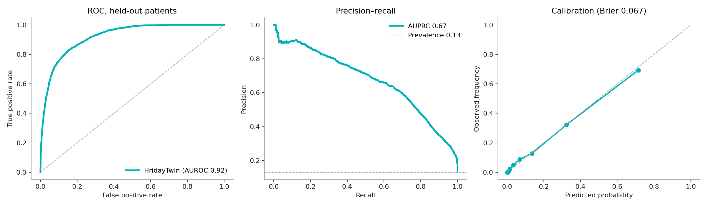
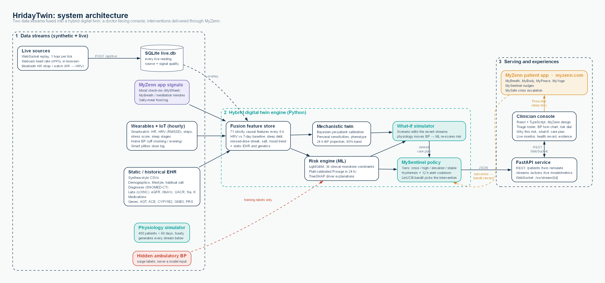

# HridayTwin: a stress-aware digital twin for hypertension

> Predicts a sustained blood-pressure surge **24 hours before it happens**, explains why, simulates which
> intervention would prevent it, and sends the plan to the patient's MyZenn app.
>
> Happiest Health **Digital Twin Challenge 2026**, hypertension track. Built on [MyZenn](https://myzenn.com).







---

## Team details

**Team name:** AlphaGo
**College / incubator:** Jadavpur University, Kolkata

| Role | Name | Programme / department | Email |
|---|---|---|---|
| Team leader | [Name] | [Programme, department] | [email] |
| Member | [Name] | [Programme, department] | [email] |
| Member | [Name] | [Programme, department] | [email] |
| Member | [Name] | [Programme, department] | [email] |

Submission folder name: `AlphaGo_Jadavpur University`

## Submission checklist

| Item | Where |
|---|---|
| Team details | [Team details](#team-details): AlphaGo |
| College / incubator information | Jadavpur University, Kolkata |
| Project title | **HridayTwin: a stress-aware digital twin for hypertension** |
| Problem statement | [Problem statement](#problem-statement-and-healthcare-use-case) |
| Healthcare use case | [Use case](#problem-statement-and-healthcare-use-case): predict a hypertensive surge 24 h ahead |
| Technical stack | [Technical stack](#technical-stack-and-aiml-model) |
| AI/ML model or framework details | [AI/ML model](#the-hybrid-twin): LightGBM + Bayesian mechanistic twin + LinUCB bandit |
| Demo video (20 min, unlisted YouTube) | **[YouTube link: to be added]** · script in [docs/VIDEO_SCRIPT.md](docs/VIDEO_SCRIPT.md) |
| Open-source license | [MIT](LICENSE) |
| Architecture diagram (PDF) | [docs/HridayTwin_Diagrams.pdf](docs/HridayTwin_Diagrams.pdf) (8 diagrams) · one-page poster [docs/HridayTwin_Architecture.pdf](docs/HridayTwin_Architecture.pdf) |
| Presentation (PPT/PDF) | [docs/HridayTwin_Presentation.pptx](docs/HridayTwin_Presentation.pptx) |
| Public access | Repository is public; every file and link above opens without sign-in |

---

## Problem statement and healthcare use case

WHO (2023) estimates **188 million Indian adults** live with hypertension and only **about 15%** have it under control.
Blood pressure is measured in clinic every few months, but dangerous surges happen on ordinary days in between. They are
usually triggered by everyday factors: **stress, short or broken sleep, missed doses and salty meals**. These show up in a
smartwatch and a wellness app *before* they show up on the cuff: HRV falls, resting heart rate drifts up, sleep fragments,
mood check-ins drop.

**Use case.** A GP or cardiologist manages a panel of hypertensive patients. Each morning the HridayTwin console shows:

1. **Predict**: every patient ranked by the probability of a sustained surge (≥160/100 mmHg for 2+ hours) in the next 24 h.
2. **Explain**: which drivers push this patient's risk today, plus their personal sensitivities ("+3.8 mmHg per 10 stress points").
3. **Simulate**: what-if sliders (MyBreath minutes, extra sleep, adherence, low salt, walking). The twin re-runs live.
4. **Act**: prescribe the protocol that the twin says works best for *this* patient. It goes to the patient's MyZenn app.
   Crisis-range readings trigger a MySafe escalation.

**Condition chosen:** hypertension. **Adverse event predicted:** hypertensive surge in the next 24 hours.

---

## Results (100 held-out patients)

| Metric | Value |
|---|---|
| AUROC, surge in next 24 h | **0.920** |
| AUPRC (prevalence 0.13) | 0.672 |
| Brier score | 0.067 |
| Surges flagged in advance (risk ≥ 30%) | **79%** |
| Median warning before onset | **19 hours** |
| Caught surges flagged ≥ 6 h ahead | 96% |
| High tier (≥ 55%): sensitivity / specificity / PPV | 0.48 / 0.97 / 0.72 |

**Fusion ablation (AUROC):** fusion 0.920 · all dynamic streams 0.918 · home cuff only 0.886 · clinical rule (last home SBP) 0.850 ·
EHR only 0.799 · wearables + MyZenn only 0.78.

**Twin validation:** the per-patient twin recovers each patient's hidden stress sensitivity with Spearman ρ = 0.76
(medication effect 0.59, salt 0.47, sleep 0.45). The true main driver is in the twin's top two for 84% of patients.

**Camera heart rate (rPPG):** within 3 bpm of the true rate on synthetic camera signals from 62 to 110 bpm, with noise,
lighting drift and frame jitter (`npm run test:rppg`).

**Intervention policy (MySentinel):** the learned LinUCB policy cuts 24 h risk by 16 points on average, versus 8.5 for a
random choice and 18 for the best possible choice.

All numbers are written to `artifacts/metrics.json` by the training run; plots are in `artifacts/plots/`.



---

## Technical stack and AI/ML model

| Layer | Technology |
|---|---|
| Data simulation | Python, NumPy, pandas; Synthea-style EHR CSVs; Parquet streams |
| Risk engine | LightGBM (gradient-boosted trees), 36 clinical monotonicity constraints, Platt calibration, TreeSHAP explanations |
| Mechanistic twin | Bayesian linear physiology model, per-patient posterior with a population prior (NumPy) |
| Intervention policy | LinUCB contextual bandit (Python port of MyZenn's `LinUCB.ts`) |
| API | FastAPI + Uvicorn |
| Clinician console | React 18, TypeScript, Vite, Recharts, lucide-react; MyZenn design tokens |
| Real-time streaming | WebSocket replay (FastAPI), one hour of sensor data per tick, twin re-scored every tick |
| Live sensors | Web Bluetooth heart-rate profile (MyZenn `useBiometricDevice` hook); webcam rPPG (POS method, in-browser FFT) |
| Live data store | SQLite (`data/live.db`): every live reading persisted with source and signal quality |
| Tests | pytest |

### Two data streams

**Static / historical EHR** (`data/ehr/`, Synthea-style): demographics and lifestyle (diet, daily salt, tobacco, alcohol,
occupation); diagnoses in SNOMED-CT (T2DM, CKD, OSA, anxiety, depression, prior MI, stroke); 3-point lab history in LOINC
(HbA1c, glucose, lipids, creatinine, eGFR, Na, K, UACR, TSH, clinic BP, BMI); medications; genetic markers
(AGT M235T rs699, ACE I/D rs1799752, CYP11B2 −344C/T rs1799998, GNB3 C825T rs5443, BP polygenic score).

**Dynamic wearable / IoT** (`data/streams/`, hourly): heart rate, HRV (RMSSD), steps, stress score, sleep stages and
efficiency; home BP cuff (morning and evening, often skipped); smart-pillbox dose log; MyZenn food log, mood check-ins
and breathing/meditation sessions.

### Real-time data

The dynamic stream reaches the twin three ways, all in the **Live monitor** tab:

1. **Streaming replay (WebSocket `/ws/stream/{id}`).** A patient's wearable, cuff, pillbox and app data is played forward one
   hour per tick. The twin re-scores on every tick and emits events: cuff readings, missed doses, mood check-ins, and
   MySentinel alerts with drivers and the recommended protocol. Alerts use hysteresis and a 12-hour cooldown so they
   don't flap. The hidden true BP can be overlaid (evaluation only) to show that alerts come before surges. One-click
   *suggested moments* pick held-out patients who were stable and then got an early warning before their first surge in
   3 days (for example, 21 hours ahead for a stress-driven surge).
2. **Camera heart rate (rPPG).** The webcam measures heart rate with no wearable. Skin colour changes with each heartbeat; the
   POS algorithm (Wang et al., 2017) extracts the pulse and an FFT gives the rate. It runs entirely in the browser: video never
   leaves the device, and only the number is sent. A signal-quality gate and a skin-colour check stop a bad signal or a
   non-face object from producing a reading. Camera HRV is shown as experimental but not sent, because RMSSD is too
   sensitive to beat-timing noise; the self-test shows why.
3. **Bluetooth heart-rate strap or watch.** MyZenn's `useBiometricDevice` hook reads the standard BLE heart-rate profile,
   including RR intervals, so it provides true HRV.

Every live reading is **stored** (SQLite) with its source and quality, so live sources build real history. The readings
from the active session (after the last *stop*, within 10 minutes) are overlaid on the twin's most recent hours, and the
risk updates within seconds. *Stop and restore* ends the session but keeps the history.

### Sandbox rules: synthetic by design

`twin_engine/simulator.py` generates 400 patients × 60 days (576,000 hourly rows) from a **causal physiology model**:

```
SBP(t) = base(age, BMI, CKD, diabetes, genes, salt) − meds × adherence + β·stress + γ·sleep debt
         + salt sensitivity · salt load + circadian (nocturnal dip, morning surge) + activity + noise
```

Stress episodes build over 1–2 days (the early-warning window). Adherence gaps, festival meals and sleep loss
arrive stochastically. The hidden ambulatory BP defines the labels: 4,577 surges in total. **The model never sees it.** It only gets
what a real clinic would get: sparse cuff readings, wearables, app logs and the EHR. No real patient data is used (DPDP Act, HIPAA).

### The hybrid twin

- **Fusion feature store** (`features.py`): 71 features every 6 h, strictly causal (a test proves that corrupting all future
  data leaves the features unchanged). Includes HRV vs 7-day baseline, sleep debt, missed-dose streak, logged salt, mood trend,
  plus static EHR and genetics.
- **Risk engine** (`model.py`): LightGBM with monotonicity constraints (for example, more doses taken can never raise risk;
  lower HRV can never lower it), Platt-calibrated. Patient-level split 240 / 60 / 100.
- **Mechanistic twin** (`twin.py`): per-patient Bayesian calibration of personal sensitivities on the patient's own cuff
  readings; phenotype; 24 h BP projection with an 80% band.
- **What-if** (hybrid counterfactual): a scenario edits the patient's recent streams, the physiology model propagates the
  change into BP, and the ML model re-scores the risk.
- **MySentinel** (`sentinel.py`): policy tiers (crisis → MySafe, high → clinician alert, medium → nudge) and a LinUCB bandit
  pre-trained in silico on 1,500 twin cases.



### Diagrams

All eight are in one PDF, [docs/HridayTwin_Diagrams.pdf](docs/HridayTwin_Diagrams.pdf), and as separate PDF/PNG files in
[docs/diagrams/](docs/diagrams/). They are generated with Graphviz by `python docs/make_diagrams.py`.

| # | Diagram | Shows |
|---|---|---|
| 1 | [System architecture](docs/diagrams/01_system_architecture.pdf) | Data streams → hybrid twin engine → API, console and MyZenn |
| 2 | [ML pipeline](docs/diagrams/02_ml_pipeline.pdf) | Simulator → features and labels → patient split → LightGBM → calibration → evaluation |
| 3 | [Real-time flow](docs/diagrams/03_realtime_flow.pdf) | WebSocket replay, camera rPPG and Bluetooth into the live twin and MySentinel alerts |
| 4 | [Hybrid twin and what-if](docs/diagrams/04_hybrid_twin_whatif.pdf) | Bayesian calibration, scenario propagation, ML re-scoring, ranked care plan |
| 5 | [MySentinel decision flow](docs/diagrams/05_mysentinel_decision.pdf) | Crisis / high / elevated / stable tiers, cooldown, bandit, outcome feedback |
| 6 | [Causal simulator](docs/diagrams/06_causal_simulator.pdf) | What causes each surge in the synthetic cohort, hidden versus observed |
| 7 | [Clinician workflow](docs/diagrams/07_clinician_workflow.pdf) | Doctor, twin and patient lanes for one morning |
| 8 | [Privacy and deployment](docs/diagrams/08_privacy_deployment.pdf) | What stays on the device, the server, the clinic; synthetic-only training |

---

## Quick start

Requirements: Python 3.10+ and Node 18+.

```bash
# Windows:     ./run.ps1
# macOS/Linux: ./run.sh
```

Or step by step:

```bash
pip install -r requirements.txt
python -m twin_engine.simulator --patients 400 --days 60   # ~20 s → data/
python -m twin_engine.train                                # ~2 min → artifacts/ (model, metrics, plots)
cd dashboard && npm install && npm run build && cd ..      # clinician console → dashboard/dist
python -m uvicorn api.main:app --port 8000                 # open http://localhost:8000
python -m pytest -q                                        # 9 tests: leakage, split, calibration, monotonicity, real-time
cd dashboard && npm run test:rppg                          # camera heart-rate accuracy self-test
```

For UI development, run `npm run dev` in `dashboard/` (port 5173, proxies `/api` to 8000).
Routes: `/` is the landing page (the 9-step journey, a live what-if on a real patient, evidence, the MyZenn toolkit);
`/console` is the clinician console. Console deep links: `/console?patient=HT-0278`, `/console?view=evidence`,
`/console?patient=HT-0036&view=records`, `/console?view=live&autoplay=1` (starts the first suggested replay).
The older `/?patient=…` and `/?view=…` forms still open the console. The landing page's numbers come from the trained
model via `python docs/make_landing_data.py`; re-run it after retraining.

### Demo walkthrough (5 minutes)

1. Roster: note the tier counts and phenotype badges. Open **Sneha Nair** (crisis): MySafe banner, one-click escalation.
2. Open **Sunita Patel (HT-0278)**, adherence-dependent: the care plan ranks *Adherence rescue* first (64% → 17%).
3. What-if: MyBreath 20 min + 1 h sleep + every dose → risk falls to about 6%; the dashed curve shows the new BP projection.
4. Drag the **twin clock** back a few days and tick *Show actual surges*: alerts rise before the red surge windows.
5. **Live monitor**: click the first *suggested moment*. Watch risk climb and a MySentinel alert fire while the true BP
   (dotted) is still below 160, then the surge arrives. Prescribe straight from the alert.
6. **Camera heart rate**: *Start camera*, keep your forehead in the teal box for about 10 seconds; your heart rate flows into
   the twin. Or pair a Bluetooth strap.
7. **Model evidence**: ablation, calibration, lead time, twin validation, bandit performance.

### API

| Endpoint | Purpose |
|---|---|
| `GET /api/patients?at=` | Triage roster (held-out patients) |
| `GET /api/patients/{id}` | EHR record |
| `GET /api/patients/{id}/streams?at=&days=7` | Wearable, cuff, pillbox, mood, sleep streams |
| `GET /api/patients/{id}/twin?at=` | Risk, tier, explanation, sensitivities, phenotype, projection, ranked care plan |
| `POST /api/patients/{id}/simulate` | What-if scenario → new risk and projection |
| `POST /api/patients/{id}/actions` | Prescribe / tele-consult / medication review / MySafe |
| `POST /api/live/{id}` | Send a live HR/HRV reading (source: bluetooth, camera or demo; optional quality) |
| `DELETE /api/live/{id}` | Stop the live session (history is kept) |
| `GET /api/live/{id}/history` | Stored live readings and session status |
| `GET /api/stream/presets` | Suggested replay moments (early warning before a surge) |
| `WS /ws/stream/{id}?start=&interval=` | Real-time replay; send `{"cmd": "pause"}`, `{"cmd": "resume"}` or `{"cmd": "speed", "interval": s}` |
| `GET /api/model/metrics` | All evaluation metrics |

Interactive docs: `http://localhost:8000/docs`.

---

## Repository layout

```
twin_engine/        simulator, fusion features, risk model, hybrid twin, MySentinel, training, runtime service
api/                FastAPI app (serves the built console at /)
dashboard/          React + TypeScript clinician console
data/               generated synthetic EHR, streams and hidden ground truth
artifacts/          trained model, calibrator, twin prior, bandit, metrics.json, plots
docs/               diagrams (Graphviz PDF/PNG), presentation PPTX, video script, ideation, screenshots
myzenn_reused/      MyZenn source files reused or ported (BLE hook, LinUCB, MyOracle, MySentinel plan, design system)
tests/              pytest suite
```

### What comes from MyZenn

| MyZenn asset | Use in HridayTwin |
|---|---|
| `useBiometricDevice.ts` (MyPulse) | Live Bluetooth HR/HRV streaming into the twin (used as-is in the console) |
| MyZenn camera pipeline (MyMirror, MyGaze, MyYoga use `getUserMedia`) | Basis for the in-browser webcam heart-rate (rPPG) module |
| `LinUCB.ts` / `useCompassRL.ts` (MyCompass) | Ported to Python as MySentinel's intervention bandit |
| MySentinel proactive-intervention plan | Policy tiers, safety guardrails, reward design |
| `useMoodForecaster.ts` (MyOracle) | Design basis for on-device forecasting and privacy boundary |
| MySanctuary tools (MyBreath, MyBody, MyPeace, MyYoga) | The interventions the twin prescribes; each care-plan item links to the live tool on [myzenn.com](https://www.myzenn.com) (for example [MyBreath](https://www.myzenn.com/mysanctuary/mybreath)) |
| MySafe | Crisis escalation path; the crisis banner links to [MySafe](https://www.myzenn.com/mysafe) |
| Design system (`theme.css`, MyZen teal) | Console visual language |

---

## Limitations and next steps

- Trained and evaluated on **synthetic** data only. Next: retrain on MIMIC-IV and open wearable datasets, then a prospective
  pilot with ambulatory BP as ground truth.
- Night-time BP is projected with a population dip, because home cuffs don't measure at night.
- Camera heart rate is validated on synthetic camera signals; it still needs testing against a reference device across skin
  tones and lighting. Camera HRV is not used.
- Live readings adjust the twin's last few hours; they are not yet re-aligned to the simulated clock as a full new history.
- Single-driver phenotype accuracy (60%) is below the majority baseline (67%), so we present the top-two driver view (84%).
- Intervention effect sizes in the what-if simulator are conservative, direction-of-evidence estimates, not trial results.
- Not a medical device. HridayTwin is a research prototype and must not be used for clinical decisions.

## License

[MIT](LICENSE). Synthetic data generated by this repository is released under the same license.
